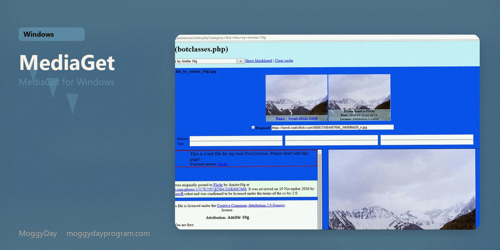
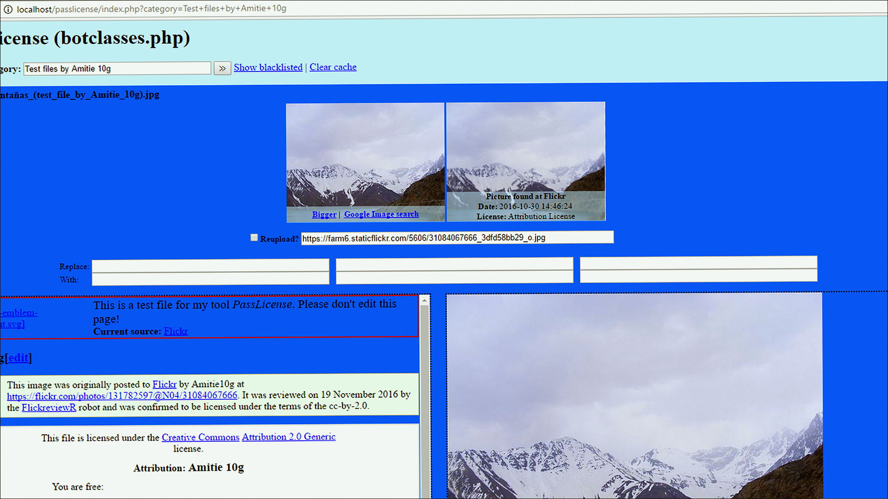
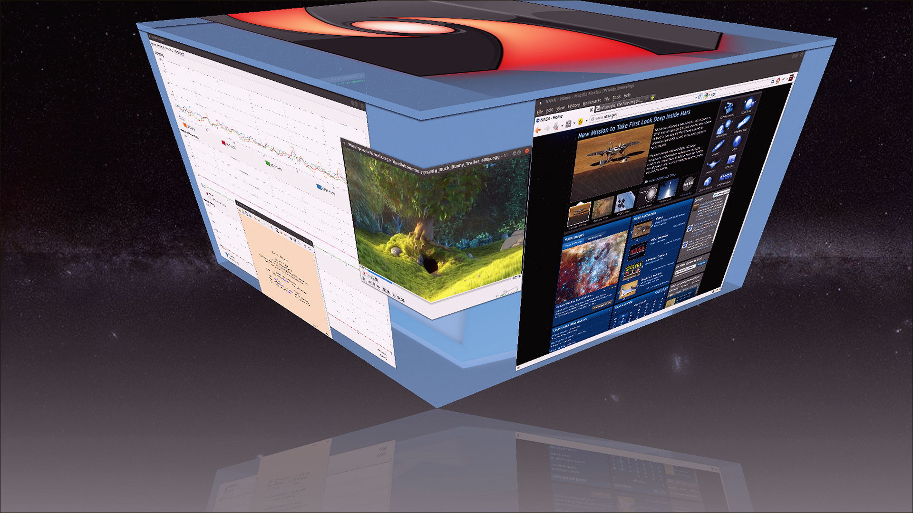
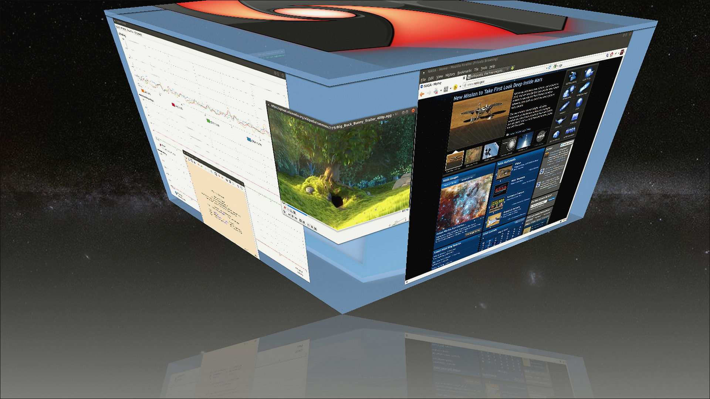

# MediaGet 2.1

MediaGet for Windows. MediaGet on Windows 10/11 x64. 1.6 MB. Requirements, screenshots, MoggyDay Launcher.

[Pages](https://meshherbalistknow.github.io/mediaget-windows/) · [RU](https://moggydayprogram.com/programs/mediaget) · [EN](https://moggydayprogram.com/en/programs/mediaget)

  

  
  
  

1. Open the RU or EN card on moggydayprogram.com
2. Press **Download** on that card. The file is only on moggydayprogram.com — not in this repo.

Category: [Utilities catalog](https://moggydayprogram.com/categories/utilities)

- [qBittorrent](https://moggydayprogram.com/programs/qbittorrent)
- [uTorrent Pro](https://moggydayprogram.com/programs/utorrent)
- [Internet Download Manager](https://moggydayprogram.com/programs/internet-download-manager)

No installer in this git repo.
